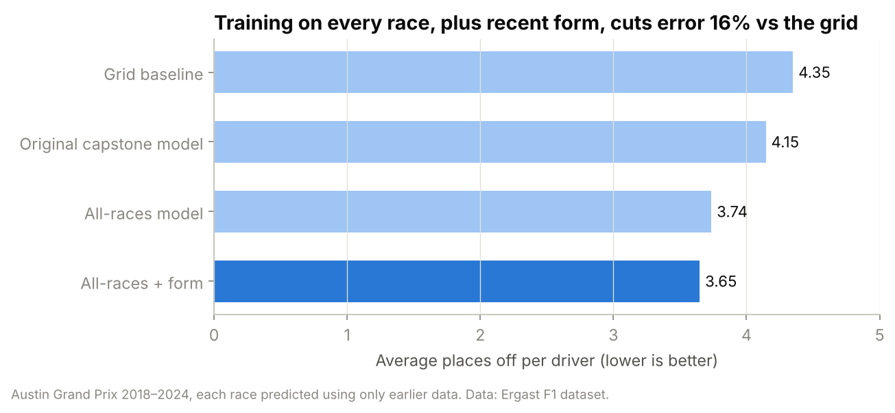
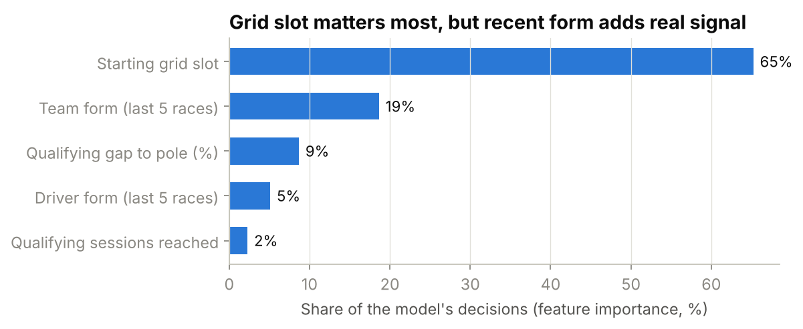

# Predicting the Austin Grand Prix

Can qualifying data predict how a Formula 1 race at the Circuit of the Americas will finish? This project started as my M.S. in Artificial Intelligence capstone and was then tested honestly against the simplest possible rule, **"drivers finish where they start"**, and improved.

**By Tanya Sasnouskaya** · M.S. Artificial Intelligence · sports data analyst · [LinkedIn](https://www.linkedin.com/in/tanya-sasnouskaya-69208a297)

---

## Results



Each Austin race from 2018 to 2024 was predicted using **only data from before that race**, exactly as the model would be used on a real race weekend.

| Approach | Avg. places off per driver | Winner picked | Podium finishers picked |
|---|---|---|---|
| Grid baseline (finish = start) | 4.35 | 2 / 6 | 12 / 18 |
| Original capstone model (Austin races only) | 4.15 | **3 / 6** | 9 / 18 |
| All-races model | 3.74 | 2 / 6 | 12 / 18 |
| **All-races + recent form** | **3.65** | 2 / 6 | 11 / 18 |

- **The grid is a tough baseline.** Copying the starting order is already within about 4 places per driver.
- **The original capstone model beats it**, and picks the most winners, but six earlier Austin races give it only around a hundred examples to learn from.
- **Training on every race since 2014 and adding recent form cuts error 16%** compared with the grid. Recent team and driver results capture who is quick *right now*, which a single qualifying session can miss.
- **It holds beyond Austin.** Across all 68 races of the 2022–2024 seasons, the form-aware model is off by 3.20 places versus 3.51 for the grid, and picks the winner 56% of the time versus 51% for "pole wins".

### 2024 case study

The form-aware model's predicted top five (Norris, Verstappen, Sainz, Piastri, Leclerc) was **exactly the real top five**, just in a different order: Charles Leclerc won from 4th on the grid, ahead of Sainz and Verstappen.

### What drives the prediction



Starting position dominates, but team form is the second-strongest signal, ahead of raw qualifying pace.

## How it works

**Features (all known before the race):** starting grid slot, best qualifying lap and gap to pole, how far a driver got in qualifying (Q1, Q2 or Q3), the driver's average finish over their last five races, and the team's average points over its last five races.

**Model:** gradient-boosted trees (scikit-learn `GradientBoostingRegressor`) predicting finishing position, then ranking drivers by prediction.

**Evaluation:** walk-forward backtest, so a race is never predicted with information from after it. Metrics are mean absolute error in finishing places, winner accuracy and podium overlap.

**Limitations:** crashes, mechanical failures and safety cars are unpredictable from pre-race data and account for much of the remaining error. Six Austin races is a small test set, which is why the results are also checked on 68 races across three seasons.

## Repository

```
├── notebooks/
│   ├── austin_gp_prediction.ipynb   # main analysis: backtest, results, charts (start here)
│   └── exploration/                 # original capstone exploration notebooks
├── src/features.py                  # pre-race feature builder (Ergast data)
├── fastf1_pipeline/                 # original live pipeline using the FastF1 API
│   ├── data_builder.py              #   qualifying features + race results per Grand Prix
│   ├── train.py                     #   train on 2018–2023, test on 2024
│   └── predict_2025.py              #   predict a new race from its qualifying session
├── models/model_austin_2024.pkl     # trained capstone model
└── figures/
```

## Run it yourself

```bash
git clone https://github.com/yournightmare27/Austin-GP.git
cd Austin-GP
pip install -r requirements.txt
```

1. Download the Ergast CSVs (see [`data/README.md`](data/README.md)) into `data/`, then open `notebooks/austin_gp_prediction.ipynb`.
2. For the live pipeline, which fetches qualifying data on a race weekend: `cd fastf1_pipeline && python train.py`, then `python predict_2025.py`.

## Data credits

- Historical results and qualifying: the Ergast F1 database, via the Kaggle dataset [Formula 1 World Championship (1950–2024)](https://www.kaggle.com/datasets/rohanrao/formula-1-world-championship-1950-2020) by Rohan Rao.
- Live session data: [FastF1](https://github.com/theOehrly/Fast-F1).

Code is MIT-licensed.
